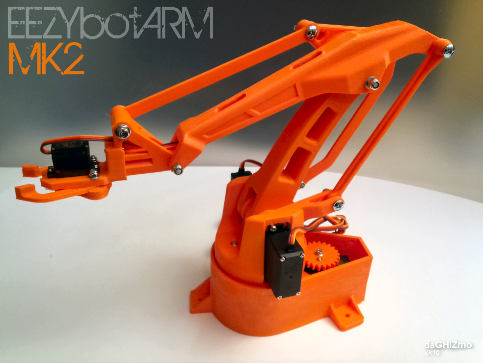

# Roboterarm (EEZYbotARM MK2)

Ein 3D-gedruckter Roboterarm, gesteuert von einem **Arduino Uno** mit einem **Joy-it-Gamepad**
(PS2-Protokoll). Drei Achsen und ein Greifer, bewegt mit den Analog-Sticks.

*Modell und Bild: EEZYbotARM MK2 von [daGHIZmo](https://www.thingiverse.com/thing:1454048) (CC BY-NC).*

## Inhalt

| Pfad | Was |
|---|---|
| `eezybotarm.ino` | Mein Arduino-Sketch: Gamepad lesen, Servos bewegen, Grenzen einhalten |
| `files/` | Druckteile (STL), Greifer als STEP/DWG/PDF – vom Original-Modell |
| `images/` | Bilder und Montage-Skizzen vom Original-Modell |

## Teile

**Elektronik**

- Arduino Uno
- Joy-it Gamepad (PS2-kompatibel) mit Empfänger
- 3 × Servo MG995 oder MG946 (Basis, Schulter, Ellbogen), 1 × SG90 (Greifer)
- **Externes Netzteil 5–6 V, mindestens 3 A** für die Servos

**Mechanik** (laut Original-Modell)

- 1 × Mutter M6 selbstsichernd, 1 × Schraube M6 × 25
- 2 × Mutter M3 selbstsichernd, 2 × Schraube M3 × 20, 1 × M3 × 10 Innensechskant
- 9 × Mutter M4 selbstsichernd, Schrauben M4 × 40, M4 × 30, 5 × M4 × 20, einige M4-Scheiben
- Gewindestangen M4 × 60 mm und M4 × 32 mm
- 25 × Kugel Ø 6 mm (Lager der senkrechten Achse), 1 × Kugellager 606zz

## Verkabelung

| Gamepad-Empfänger | Arduino |
|---|---|
| Data (1) | Pin 13 |
| Command (2) | Pin 11 |
| GND (4) | GND |
| Power (5) | 3,3 V |
| Attention (6) | Pin 10 |
| Clock (7) | Pin 12 |

| Servo (Signal) | Arduino |
|---|---|
| Basis-Drehung (MG995/946) | Pin 5 |
| Hauptarm / Schulter | Pin 6 |
| Vorderarm / Ellbogen | Pin 3 |
| Greifer (SG90) | Pin 9 |

> [!WARNING]
> Die Servos **nicht** aus dem 5-V-Pin des Arduino versorgen: Plus und Minus der Servos ans externe
> Netzteil, und dessen **GND mit dem Arduino-GND verbinden**. Sonst startet der Arduino bei Last neu
> oder die Servos zittern.

## Bedienung

| Eingabe | Bewegung |
|---|---|
| Linker Stick X | Basis drehen |
| Linker Stick Y | Hauptarm heben / senken |
| Rechter Stick Y | Vorderarm vor / zurück |
| R1 / L1 | Greifer schließen / öffnen |
| START | Grundstellung (alle 90°) |

## Hochladen

1. In der Arduino IDE über den Bibliotheksverwalter **„PS2X“** von Bill Porter installieren
   (oder [madsci1016/Arduino-PS2X](https://github.com/madsci1016/Arduino-PS2X) als ZIP einbinden).
2. `eezybotarm.ino` öffnen, Board **Arduino Uno**, hochladen.
3. Seriellen Monitor auf **57600 Baud**: Dort steht „Gamepad bereit.“ oder der Fehlercode.

**Nach dem Zusammenbau anpassen:** Oben im Sketch stehen die Bewegungsgrenzen
(`SHO_MIN`/`SHO_MAX`, `ELB_MIN`/`ELB_MAX`, `GRIP_OPEN`/`GRIP_CLOSED`). Erst mit kleinen Bereichen
testen und dann erweitern, damit kein Servo gegen einen Anschlag drückt. Die Geschwindigkeit
regelt `STEP` (Grad pro Durchlauf).

## Lizenz

- **3D-Modell, Druckdateien und Bilder** (`files/`, `images/`): EEZYbotARM MK2 von daGHIZmo,
  [Creative Commons Namensnennung – Nicht kommerziell](https://creativecommons.org/licenses/by-nc/4.0/),
  siehe [`LICENSE.md`](LICENSE.md). Nicht kommerziell nutzen.
- **Arduino-Sketch** (`eezybotarm.ino`): von mir geschrieben.

## Änderungen (Oktober 2026)

- README neu: statt des kopierten Thingiverse-Texts jetzt Teile, Verkabelung, Bedienung, Hochladen.
- Fehler behoben: Die Pin-Liste im Kommentar des Sketches passte nicht zum Code (Basis/Schulter/Ellbogen
  vertauscht). Kommentar und README zeigen jetzt die Pins, die der Code wirklich benutzt.
